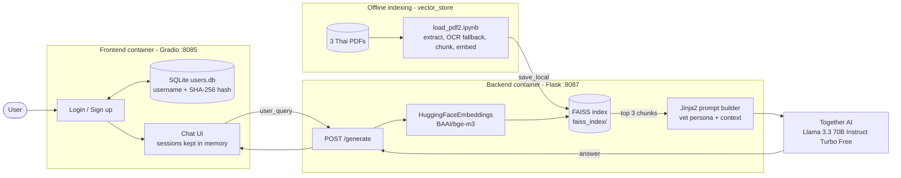
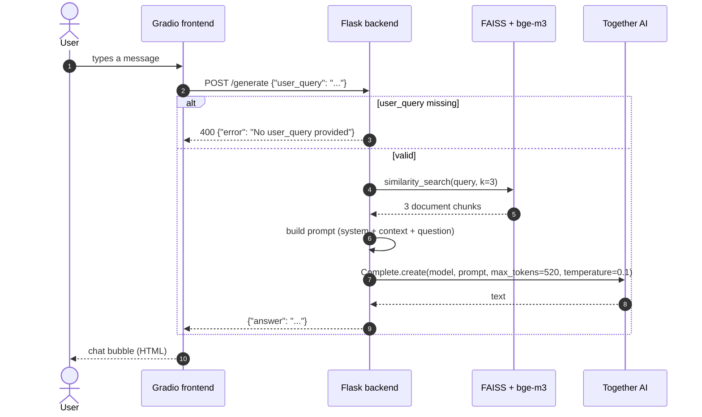
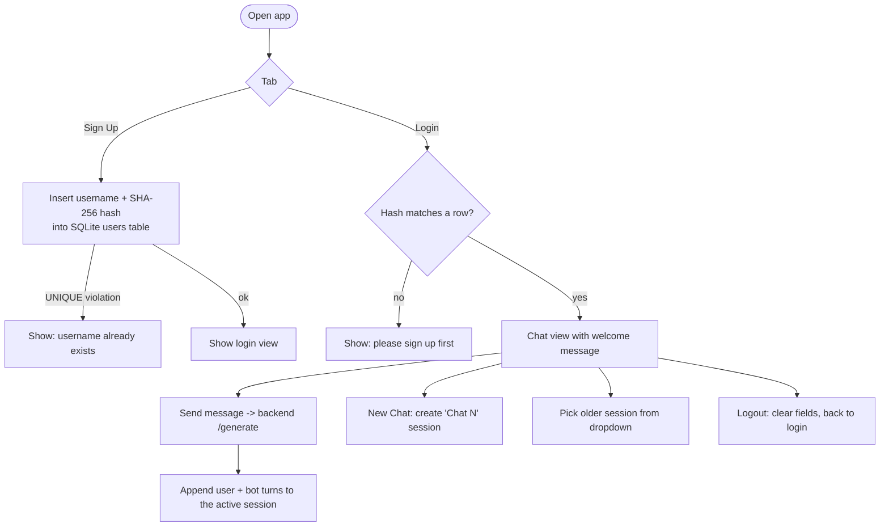
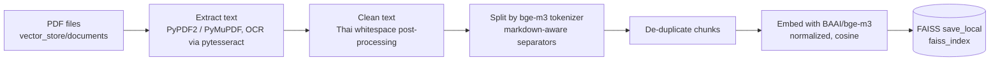
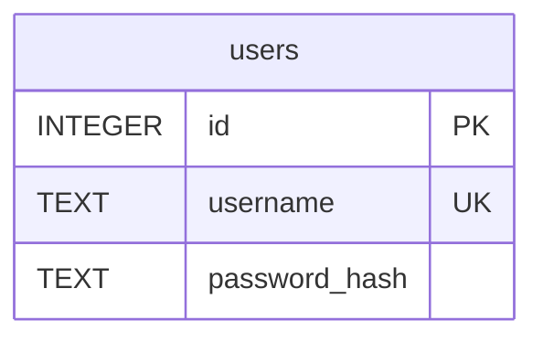

# PawPal: Pet Behavior Chatbot

**A Thai/English RAG chatbot that gives veterinarian-style advice on pet behavior problems, grounded in a small PDF knowledge base.**

    -7C3AED?style=for-the-badge) 

> **Status: course/MLOps prototype, not production.** Several security issues are documented honestly in [Security and limitations](#security-and-limitations); the most important are a credential hard-coded in the backend source and unsalted password hashing in the frontend. Do not deploy as-is.
>
> **Note on the previous README:** the old README described a different project (a "Pet Match" breed recommender using OpenAI and `all_animal_breeds.csv`). That does not match the code in this repository, which is the pet **behavior** chatbot described below. The breed recommender lives in the sibling repo `pet-match-mlops`.

Last updated: 2026-11-03.

---

## Thai summary (สรุปภาษาไทย)

PawPal คือแชทบอทให้คำแนะนำเรื่องพฤติกรรมสัตว์เลี้ยง (เช่น สุนัข แมว) ตอบเป็นภาษาไทยหรืออังกฤษในโทนสัตวแพทย์ที่เป็นมิตร ระบบค้นหาเนื้อหาที่เกี่ยวข้องจากเอกสาร PDF ภาษาไทยใน `vector_store/documents/` ด้วย FAISS + โมเดล embedding `BAAI/bge-m3` แล้วส่งบริบทให้ LLM (Llama 3.3 70B ผ่าน Together AI) สร้างคำตอบ ส่วนหน้าบ้านเป็น Gradio มีหน้าสมัครสมาชิก/เข้าสู่ระบบ (SQLite) และหน้าแชทพร้อมประวัติการสนทนาในเซสชัน หมายเหตุ: เป็นโปรโตไทป์ มีประเด็นความปลอดภัยที่ต้องแก้ก่อนใช้งานจริง (ดูหัวข้อ Security and limitations)

---

## Problem

Owners often search for pet-behavior advice (excessive barking, destructive chewing, aggression) and find generic or conflicting answers. This project grounds a chat assistant in a curated set of Thai-language documents about pet behavior and behavior correction, and constrains the answer style to a short, friendly, veterinarian-like reply in Thai or English.

## Design

| Decision | What the code does |
|---|---|
| Retrieval-augmented | `similarity_search(k=3)` over a local FAISS index; the 3 chunks are concatenated into the prompt as "Pet owner's report" context. |
| Multilingual embeddings | `BAAI/bge-m3` via `langchain_huggingface.HuggingFaceEmbeddings`, used both at indexing time (notebook) and query time (backend). |
| Prompt-constrained persona | System prompt: experienced veterinarian, answer in Thai or English only, concise, friendly. |
| Deterministic-ish decoding | `temperature=0.1`, `top_p=0.85`, `max_tokens=520`, stop sequence `Assistant:`. |
| Split services | Flask backend (port 8087) and Gradio frontend (port 8085), each with its own Dockerfile, wired by `docker-compose.yml`. |

---

## Repository layout

```
Pet-Behavior-MLops/
├── backend/
│   ├── app.py                  Flask API: POST /generate (RAG + Together completion)
│   ├── faiss_index/            index.faiss + index.pkl (prebuilt)
│   ├── requirements.txt        pinned dependencies (UTF-16 encoded file)
│   ├── Dockerfile              python:3.11.9, runs app.py
│   └── readme.md               short Thai overview
├── frontend/
│   ├── frontend.py             Gradio app: sign up / log in (SQLite) + chat UI
│   ├── requirements.txt
│   ├── Dockerfile              python:3.11.9, runs frontend.py
│   └── readme.md
├── vector_store/
│   ├── documents/              4 files: 3 Thai PDFs on pet behavior + a readme
│   ├── load_pdf2.ipynb         PDF -> text (PyPDF2/PyMuPDF/OCR) -> chunks -> FAISS
│   ├── faiss_index/            index output location
│   ├── requirements.txt
│   └── readme.md               document-processing pipeline description
└── docker-compose.yml          backend (8087) + frontend (8085)
```

---

## Tech stack

<p align="center">
  
</p>

| Layer | Choice (from the repo files) |
|---|---|
| Frontend | Gradio, `requests`, `sqlite3`, `hashlib` (SHA-256) |
| Backend | Flask 3.1.0, Jinja2 (prompt rendering), `together` 1.4.1 |
| Retrieval | `faiss-cpu` 1.10.0, `langchain-community` 0.3.19, `langchain-huggingface` 0.1.2 |
| Embedding model | `BAAI/bge-m3` (sentence-transformers 3.4.1, torch 2.6.0) |
| LLM | `meta-llama/Llama-3.3-70B-Instruct-Turbo-Free` on Together AI |
| Indexing (notebook) | PyPDF2, PyMuPDF (`fitz`), pytesseract OCR, `RecursiveCharacterTextSplitter` using the bge-m3 tokenizer (chunk overlap = chunk_size / 10, de-duplicated), cosine distance |
| Container | Docker (`python:3.11.9`), Docker Compose (file format `3.7`) |

---

## System architecture



## Flow 1: Asking a question (sequence)



## Flow 2: Account and chat session (frontend)



## Flow 3: Building the knowledge base (offline)



---

## API

| Method | Path | Body | Success | Errors |
|---|---|---|---|---|
| POST | `/generate` | JSON `{"user_query": "<text>"}` | `200 {"answer": "<text>"}` | `400 {"error": "No user_query provided"}` when the body or key is missing |

The backend listens on `0.0.0.0:8087` (`app.run`). There is no other route, no auth on the API, and no health endpoint.

## Data model (frontend, SQLite)



Created on startup by `frontend.py` (`users.db`, `CREATE TABLE IF NOT EXISTS`). Chat history is held in Gradio state only and is lost on reload.

---

## How to run

Commands below come from files in this repository (`docker-compose.yml`, Dockerfiles, `*.py`). I have not executed them.

**Docker Compose** (builds both images; backend 8087, frontend 8085):

```bash
docker compose up --build
```

**Without Docker** (each service has a `requirements.txt`; backend `app.py` loads the index from `./faiss_index`, so run it from `backend/`):

```bash
# terminal 1
cd backend && pip install -r requirements.txt && python app.py
# terminal 2
cd frontend && pip install -r requirements.txt && python frontend.py
```

Then open `http://localhost:8085`.

**Rebuilding the index:** open `vector_store/load_pdf2.ipynb`. It reads `HUGGINGFACE_API_KEY` from the environment (via `python-dotenv`), and on Windows expects Tesseract at `C:\Program Files\Tesseract-OCR\tesseract.exe`.

**Known wiring issues (ASSUMPTION: these were not changed here):**

- `frontend.py` posts to a hard-coded backend URL (`http://35.247.140.245:8087/generate`), not to the Compose `backend` service. To use your own backend, edit `get_pet_advice`.
- `backend/requirements.txt` and `frontend/requirements.txt` are UTF-16 encoded; some pip versions may not read them. Re-save as UTF-8 if install fails.
- `backend/Dockerfile` copies `faiss_index/` into the image but does not set any Together key; the key is currently inside the source (see below).

## Testing and evaluation

There are no automated tests, no retrieval metrics and no answer-quality evaluation in this repository. Answer quality is unverified. Suggested next steps (not implemented): a small gold set of behavior questions with expected source chunks, retrieval hit-rate, and faithfulness checks.

---

## Security and limitations

| Issue | Detail | Recommended fix |
|---|---|---|
| Hard-coded API credential | `backend/app.py` assigns a Together API key as a string literal. It is in git history and must be treated as leaked: **revoke and rotate it**, then load from an environment variable (a `.env` loader import already exists but is unused). | Rotate, use env var / secret manager, scan history with gitleaks. |
| Weak password storage | Frontend stores unsalted SHA-256 hashes. | Use bcrypt/argon2 with per-user salt. |
| Unauthenticated, plain-HTTP API | The frontend calls the backend over `http://` to a hard-coded public IP; the API has no auth or rate limit. | TLS, auth token, rate limiting, config via env var. |
| Unsafe deserialization flag | FAISS is loaded with `allow_dangerous_deserialization=True`; only load indexes you built yourself. | Keep index provenance; sign or hash index files. |
| HTML injection risk | Chat text is interpolated into HTML bubbles without escaping. | Escape user and model text. |
| Not veterinary advice | Output is LLM-generated from three PDFs; it can be wrong or incomplete. Sick or aggressive animals need a real veterinarian. | Add a visible disclaimer and escalation guidance. |
| Privacy | User queries are sent to a third-party LLM API (Together AI). No PII masking is implemented. | Document data flow; mask PII; PDPA review before real users. |
| Prompt injection | Retrieved text is inserted into the prompt without sanitisation (low risk with a fixed curated corpus). | Treat retrieved content as untrusted. |

## Credits

Authorship is not stated in the repo files; the sub-READMEs reference an original `gardio_chatbot` repository and the logo is hosted under another GitHub account, so this repo appears to be a fork or team project (ASSUMPTION). Embeddings: BAAI `bge-m3`. LLM served by Together AI. Source PDFs in `vector_store/documents/` belong to their respective authors.
