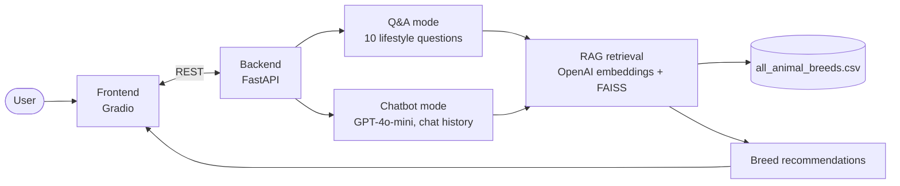

<div align="center">

# Pet Match (Pet Behavior)

**A Thai-language AI assistant that recommends pets for your lifestyle with RAG.**

   

</div>

## Tech stack

<p align="center">
  
</p>

## Architecture



---

โปรเจกต์นี้คือเว็บแอปพลิเคชันสำหรับแนะนำสัตว์เลี้ยงที่เหมาะสมกับไลฟ์สไตล์และความต้องการของผู้ใช้ โดยใช้เทคโนโลยี AI และ Large Language Model (LLM) ในการประมวลผลและให้คำแนะนำ

ผู้ใช้สามารถค้นหาสัตว์เลี้ยงในฝันได้ 2 รูปแบบ:

1.  **Match Your Pet (ค้นหาคู่หูที่ใช่):** ตอบคำถามเป็นขั้นตอนเพื่อจำกัดวงและค้นหาสายพันธุ์ที่ตรงกับความต้องการของคุณมากที่สุด
2.  **Paws & Claws Chat (แชทกับผู้ช่วย):** พูดคุยกับแชทบอทผู้ช่วยอัจฉริยะ สามารถให้คำแนะนำจากบทสนทนาที่เป็นธรรมชาติ และตอบคำถามทั่วไปเกี่ยวกับสัตว์เลี้ยงได้

## ✨ คุณสมบัติหลัก (Key Features)

  * **ระบบแนะนำสัตว์เลี้ยงอัจฉริยะ:** ใช้เทคนิค Retrieval-Augmented Generation (RAG) โดยดึงข้อมูลจากไฟล์ `all_animal_breeds.csv` เพื่อให้คำแนะนำสายพันธุ์ที่แม่นยำและมีข้อมูลสนับสนุน
  * **สองโหมดการใช้งาน:**
      * [cite\_start]**โหมด Q\&A:** นำผู้ใช้ผ่านชุดคำถาม 10 ข้อเกี่ยวกับไลฟ์สไตล์และความชอบ เช่น ขนาด, ความขี้เล่น, การเข้ากับเด็ก, งบประมาณ และอื่นๆ [cite: 1]
      * [cite\_start]**โหมด Chatbot:** รองรับการสนทนาภาษาไทยที่เป็นธรรมชาติ หากผู้ใช้พิมพ์ความต้องการ เช่น "อยากได้หมาตัวเล็กๆ ไม่เห่า" ระบบจะวิเคราะห์และให้คำแนะนำสายพันธุ์ทันที [cite: 1] [cite\_start]สำหรับคำถามทั่วไป บอทจะตอบในฐานะผู้ช่วยที่เป็นมิตร [cite: 2]
  * [cite\_start]**ส่วนติดต่อผู้ใช้ที่เป็นมิตร:** พัฒนาด้วย Gradio ทำให้ใช้งานง่าย สวยงาม และตอบสนองได้ดี [cite: 1]
  * [cite\_start]**Backend ประสิทธิภาพสูง:** พัฒนาด้วย FastAPI รองรับการทำงานแบบอะซิงโครนัส ทำให้การสื่อสารรวดเร็ว [cite: 2]

## 🏗️ สถาปัตยกรรม (Architecture)

โปรเจกต์นี้แบ่งการทำงานออกเป็น 2 ส่วนหลัก:

1.  **Frontend (ส่วนหน้าบ้าน):**

      * [cite\_start]สร้างด้วย `Gradio` เพื่อสร้างหน้าเว็บแบบอินเทอร์แอคทีฟ [cite: 1]
      * [cite\_start]รับข้อมูลจากผู้ใช้ (การเลือกตอบคำถาม หรือข้อความในแชท) แล้วส่งคำขอไปยัง Backend ผ่าน HTTP requests [cite: 1]
      * [cite\_start]แสดงผลลัพธ์ที่ได้รับกลับมาจาก Backend [cite: 1]

2.  **Backend (ส่วนหลังบ้าน):**

      * [cite\_start]สร้างด้วย `FastAPI` และจัดการ API สองเส้นทางหลักคือ `/recommend` และ `/chat` [cite: 2]
      * [cite\_start]**`/recommend`:** ใช้ `LangChain` ร่วมกับโมเดล `gpt-4o-mini` และเทคนิค RAG [cite: 2] [cite\_start]โดยสร้าง Vector Store จากข้อมูลสัตว์เลี้ยงด้วย `FAISS` และ `OpenAIEmbeddings` เพื่อค้นหาข้อมูลที่เกี่ยวข้องที่สุดมาประกอบการให้คำแนะนำ [cite: 2]
      * [cite\_start]**`/chat`:** ใช้โมเดล `gpt-4o-mini` ผ่าน OpenAI API เพื่อสร้างบทสนทนาทั่วไป โดยใช้ประวัติการแชทเป็นบริบทในการตอบ [cite: 2]

## 🚀 การติดตั้งและเตรียมความพร้อม (Installation and Setup)

**สิ่งที่ต้องมี (Prerequisites):**

  * Python 3.8+
  * API Key จาก OpenAI

**ขั้นตอนการติดตั้ง:**

1.  **Clone a repository:**

    ```bash
    git clone <your-repository-url>
    cd <your-repository-name>
    ```

2.  **ติดตั้ง Dependencies:**

      * **Backend:**
        ```bash
        pip install -r requirements_backend.txt
        ```
        *(สมมติว่ามีไฟล์ `requirements_backend.txt` ที่รวม `fastapi`, `uvicorn`, `langchain-openai`, `faiss-cpu`, `python-dotenv` และอื่นๆ)*
      * **Frontend:**
        ```bash
        pip install -r requirements_frontend.txt
        ```
        *(สมมติว่ามีไฟล์ `requirements_frontend.txt` ที่รวม `gradio`, `requests`, `loguru`)*

3.  **ตั้งค่า Environment Variable:**

      * สร้างไฟล์ชื่อ `.env` ในโฟลเดอร์หลักของโปรเจกต์
      * เพิ่ม `OPENAI_API_KEY` ของคุณลงในไฟล์:
        ```
        OPENAI_API_KEY="sk-xxxxxxxxxxxxxxxxxxxxxxxxxxxx"
        ```

4.  **เตรียมไฟล์ข้อมูล:**

      * [cite\_start]ตรวจสอบให้แน่ใจว่ามีไฟล์ `data/all_animal_breeds.csv` อยู่ในโปรเจกต์ตามโครงสร้างที่โค้ดอ้างอิง [cite: 2]

## 🖥️ วิธีการใช้งาน (How to Run)

1.  **เปิด Terminal 1: รัน Backend Server**

      * [cite\_start]สั่งรันเซิร์ฟเวอร์ FastAPI โดยโค้ด `frontend.py` ระบุว่าจะเชื่อมต่อไปยัง port `8088` [cite: 1]

    <!-- end list -->

    ```bash
    uvicorn backend:app --host 0.0.0.0 --port 8088
    ```

2.  **เปิด Terminal 2: รัน Frontend Application**

      * สั่งรันแอปพลิเคชัน Gradio

    <!-- end list -->

    ```bash
    python frontend.py
    ```

3.  **เข้าใช้งาน**

      * [cite\_start]เปิดเว็บเบราว์เซอร์แล้วไปที่ `http://127.0.0.1:7860` [cite: 1]
      * คุณจะพบหน้าแรกของ "Pet Match" และสามารถเริ่มใช้งานได้ทันที

## 📁 โครงสร้างไฟล์ (File Structure)

```
.
├── backend.py            # โค้ดสำหรับ Backend (FastAPI, LangChain, RAG)
├── frontend.py           # โค้ดสำหรับ Frontend (Gradio UI)
├── data/
│   └── all_animal_breeds.csv # ไฟล์ข้อมูลคุณลักษณะของสัตว์เลี้ยง
├── .env                  # ไฟล์เก็บ Environment Variables (เช่น OPENAI_API_KEY)
└── README.md             # ไฟล์ที่คุณกำลังอ่าน
```
